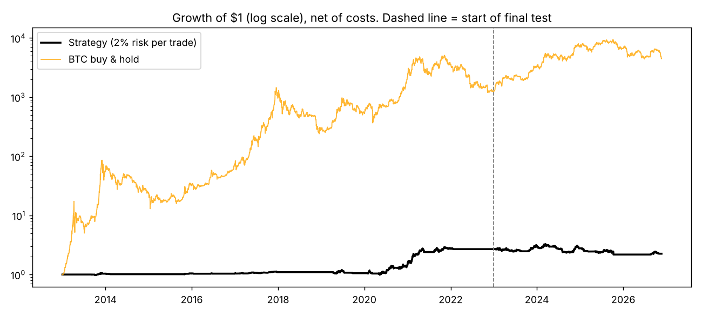

# Fibonacci swing breakout: backtest report

**Final test 2023 → 2026 (untouched until this run): 62.0% of 129 trades won.** Development 2013 → 2022: 79.1% of 158 trades.

## Rules (chosen on 2013–2022 only, by a rule fixed in advance)

- **Market filter:** BTC above its 200-day average. No new trades in bear markets.
- **Entry:** the coin closes above its prior 20-day high and above its 200-day average. Buy at the next open.
- **Fibonacci levels:** taken from the prior 20-day swing, from its low L to its high H:
  - **TP1** = 1.618 extension, **TP2** = 2.618, **TP3** = 4.236. Sell 33% / 33% / 33% of the position at each.
  - **Stop** = the swing low L, never more than 30% below entry.
  - The stop moves to breakeven after TP1, and up to TP1 after TP2.
- **Filter:** skip any setup whose TP1 is less than +10% above the entry.
- **BTC dominance rotation:** OFF. The development data preferred it off; see the comparison below.
- **Money management:** risk 2% of the account between entry and stop, cap any position at 25% of the account, at most 8 positions, no leverage.
- **Costs:** 0.10% fee + 0.05% slippage on every fill. Gaps fill at the worse open. If a stop and a TP are in the same candle, the stop is counted first.
- **Data:** BTC from Bitstamp since 2013-01-01; 19 alts from Binance since 2017–2020.

## Results

| | Trades | Win rate | Avg win | Avg loss | Profit factor | Hit TP1 / TP2 / TP3 | Return | CAGR | Max DD |
|---|---|---|---|---|---|---|---|---|---|
| Development 2013–2022 | 158 | **79.1%** | +19.1% | -29.0% | 2.49 | 79% / 34% / 13% | +169% | +10.4% | -17% |
| **Final test 2023–2026** | 129 | **62.0%** | +14.2% | -27.0% | 0.86 | 62% / 20% / 8% | -16% | -4.5% | -34% |
| Full history | 287 | **71.4%** | +17.2% | -27.8% | 1.55 | 71% / 28% / 10% | +125% | +6.0% | -34% |

BTC buy & hold: development +124,923% (max DD -85%); test +262% (max DD -53%).

Worst single trade: -2.0% of the account. Average TP1 distance: +16%; average stop distance: 28%.

## How trades ended (full history)

| Exit path | Trades | Avg return |
|---|---|---|
| stop | 81 | -28.0% |
| time | 1 | -10.8% |
| tp1+time | 6 | +15.4% |
| tp1+tp2+time | 2 | +26.0% |
| tp1+tp2+tp3 | 30 | +49.6% |
| tp1+tp2+trail2 | 48 | +26.9% |
| tp1+trail1 | 119 | +5.0% |

## BTC vs. alts (full history)

| | Trades | Win rate | Avg trade |
|---|---|---|---|
| BTC | 30 | 77% | +9.8% |
| Alts | 257 | 71% | +3.7% |

## BTC dominance rotation: on vs. off (same other rules), dominance source: proxy from ALT/BTC index (no BTC.D file found)

| | Trades | Win rate | Avg win | Avg loss | Profit factor | Hit TP1 / TP2 / TP3 | Return | CAGR | Max DD |
|---|---|---|---|---|---|---|---|---|---|
| Dominance ON, dev | 134 | **75.4%** | +17.6% | -29.0% | 1.86 | 75% / 27% / 8% | +72% | +5.6% | -16% |
| Dominance ON, test | 78 | **60.3%** | +15.8% | -26.9% | 0.89 | 60% / 18% / 9% | -11% | -2.9% | -25% |
| Dominance OFF, dev | 158 | **79.1%** | +19.1% | -29.0% | 2.49 | 79% / 34% / 13% | +169% | +10.4% | -17% |
| Dominance OFF, test | 129 | **62.0%** | +14.2% | -27.0% | 0.86 | 62% / 20% / 8% | -16% | -4.5% | -34% |

## By year

| | Trades | Win rate | Avg win | Avg loss | Profit factor | Hit TP1 / TP2 / TP3 | Return | CAGR | Max DD |
|---|---|---|---|---|---|---|---|---|---|
| 2013 | 5 | **80.0%** | +20.6% | -27.4% | 3.01 | 80% / 20% / 20% | +3% | +3.5% | -3% |
| 2014 | 1 | **0.0%** | +nan% | -30.2% | 0.00 | 0% / 0% / 0% | -2% | -2.0% | -2% |
| 2015 | 2 | **100.0%** | +10.4% | +nan% | inf | 100% / 50% / 0% | +3% | +2.6% | -1% |
| 2016 | 2 | **100.0%** | +3.7% | +nan% | inf | 100% / 0% / 0% | -0% | -0.1% | -1% |
| 2017 | 8 | **75.0%** | +22.6% | -30.2% | 2.24 | 75% / 38% / 25% | +5% | +5.2% | -3% |
| 2018 | 0 | – | – | – | – | – | +0% | +0.0% | 0% |
| 2019 | 13 | **53.8%** | +17.5% | -29.4% | 0.70 | 54% / 23% / 8% | -4% | -3.9% | -12% |
| 2020 | 54 | **81.5%** | +19.8% | -27.0% | 3.22 | 81% / 43% / 20% | +37% | +36.8% | -16% |
| 2021 | 73 | **82.2%** | +19.1% | -30.2% | 2.92 | 82% / 32% / 7% | +89% | +89.1% | -14% |
| 2022 | 0 | – | – | – | – | – | -3% | -3.4% | -3% |
| 2023 | 43 | **74.4%** | +15.0% | -26.4% | 1.65 | 74% / 21% / 12% | +13% | +12.7% | -13% |
| 2024 | 50 | **62.0%** | +13.3% | -27.6% | 0.79 | 62% / 22% / 6% | -10% | -10.2% | -29% |
| 2025 | 27 | **40.7%** | +10.8% | -26.5% | 0.28 | 41% / 11% / 0% | -21% | -21.5% | -22% |
| 2026 | 9 | **66.7%** | +21.2% | -27.2% | 1.56 | 67% / 33% / 22% | +3% | +3.8% | -8% |

## Money management: risk per trade

| | Trades | Win rate | Avg win | Avg loss | Profit factor | Hit TP1 / TP2 / TP3 | Return | CAGR | Max DD |
|---|---|---|---|---|---|---|---|---|---|
| 1% risk | 287 | **71.4%** | +17.2% | -27.8% | 1.55 | 71% / 28% / 10% | +55% | +3.2% | -18% |
| 2% risk | 287 | **71.4%** | +17.2% | -27.8% | 1.55 | 71% / 28% / 10% | +125% | +6.0% | -34% |
| 3% risk | 287 | **71.4%** | +17.2% | -27.8% | 1.55 | 71% / 28% / 10% | +207% | +8.4% | -47% |

## Read before trading

- **Few trades:** the +10% TP1 filter and the market filter make this selective, at about 20–30 trades a year. Small samples swing a lot; one bad year can look very different from the average.
- **How the win rate works:** most "wins" hit TP1 and then exit at breakeven on the rest. Those are small wins of about a third of the TP1 move. The large wins come from reaching TP2 and TP3.
- **Wide stop:** the stop sits at the swing low, up to 30% away. Money management keeps each loss near 2% of the account, which also means positions are small.
- **BTC dominance is a proxy** unless you add `data/BTC.D.csv`, a TradingView export of CRYPTOCAP:BTC.D. Then rerun `optimize.py` and `report.py`.
- **Bias:** the coin list is today's survivors. I tested 1,152 setting combinations on development data, so some of the development result is luck. The 2023–26 test is the honest number.
- Research code, not financial advice. Paper-trade first.
