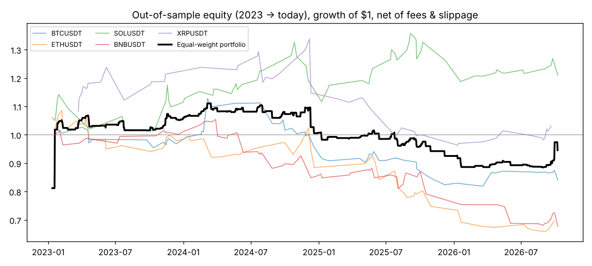

# Crypto RSI(2) Pullback Strategy: Backtest Report

**Result: out-of-sample win rate 57.3% across 328 trades: FAILS the 70% target.**

## Strategy (long only, 4-hour candles)
- **Trend filter:** close above EMA(100)
- **Entry:** RSI(2) below 5, bought at the next candle's open
- **Exit:** close above SMA(10), or stop at entry close − 3×ATR(14), or after 20 candles; filled at the next open
- **Costs:** 0.10% fee and 0.05% slippage on each side, so about 0.3% per round trip
- **Coins:** BTCUSDT, ETHUSDT, SOLUSDT, BNBUSDT, XRPUSDT (Binance spot)

## 1. In-sample vs. out-of-sample
Parameters were chosen **only** from 2019–2022 data. The 2023 to today period was never seen during tuning.

| Period | Trades | Win rate | Avg win | Avg loss | Profit factor | Avg trade | Compounded | Max DD |
|---|---|---|---|---|---|---|---|---|
| In-sample 2019–2022 | 292 | 71.2% | +3.12% | -4.46% | 1.74 | +0.94% | +961% | -28% |
| **Out-of-sample 2023–now** | 328 | 57.3% | +1.65% | -2.61% | 0.85 | -0.17% | -51% | -59% |

## 2. Walk-forward (re-optimised each year on all prior data only)

| Year | Params (trend/rsi/exit/stop/bars) | Trades | Win rate | Profit factor | Avg trade |
|---|---|---|---|---|---|
| 2021 | 100/25/10/3/20 | 555 | 70.8% (fallback*) | 1.33 | +0.44% |
| 2022 | 100/5/10/3/20 | 52 | 71.2% | 0.99 | -0.02% |
| 2023 | 100/5/10/3/20 | 89 | 61.8% | 1.40 | +0.34% |
| 2024 | 100/5/10/3/20 | 92 | 59.8% (fallback*) | 0.81 | -0.24% |
| 2025 | 200/15/10/5/60 | 248 | 60.9% (fallback*) | 0.61 | -0.46% |
| 2026 | 200/25/10/5/60 | 332 | 56.3% (fallback*) | 0.57 | -0.33% |
| **All years** | | **1368** | **64.2%** | **1.02** | **+0.02%** |

\* Fallback: no parameter set reached 70% on that year's training data, so the highest-win-rate set was used.

## 3. Out-of-sample by coin

| Coin  Trades | Win rate | Avg win | Avg loss | Profit factor | Avg trade | Compounded | Max DD | Buy & hold |
|---|---|---|---|---|---|---|---|---|---|
| BTCUSDT | 71 | 52.1% | +1.23% | -1.80% | 0.74 | -0.22% | -16% | -27% | +268% |
| ETHUSDT | 72 | 55.6% | +1.45% | -2.86% | 0.64 | -0.46% | -30% | -39% | +44% |
| SOLUSDT | 69 | 59.4% | +2.32% | -2.60% | 1.31 | +0.32% | +21% | -16% | +605% |
| BNBUSDT | 65 | 58.5% | +1.18% | -3.00% | 0.55 | -0.56% | -32% | -36% | +127% |
| XRPUSDT | 51 | 62.7% | +2.06% | -3.12% | 1.11 | +0.13% | +3% | -28% | +174% |

## 4. Out-of-sample by year

| Year  Trades | Win rate | Avg win | Avg loss | Profit factor | Avg trade | Compounded | Max DD |
|---|---|---|---|---|---|---|---|---|
| 2023 | 89 | 61.8% | +1.95% | -2.26% | 1.40 | +0.34% | +30% | -13% |
| 2024 | 92 | 59.8% | +1.71% | -3.14% | 0.81 | -0.24% | -24% | -34% |
| 2025 | 82 | 51.2% | +1.58% | -2.76% | 0.60 | -0.54% | -38% | -37% |
| 2026 | 65 | 55.4% | +1.17% | -2.14% | 0.67 | -0.31% | -20% | -29% |

## Caveats
- A high win rate comes from small, frequent wins and fewer, larger losses (compare avg win vs. avg loss). A single bad stretch can give back many wins.
- 'Compounded' assumes 100% of that coin's allocation goes into every trade, applied to each coin's trades one after another. 'Max DD' is measured on closed trades only; drawdown while a trade is open can be deeper.
- The strategy is long-only, so a long bear market produces few or losing trades. Buy & hold beat it on some coins in this bull period.
- Past performance does not guarantee future results. This is research code, not financial advice. Paper-trade it before risking money.
