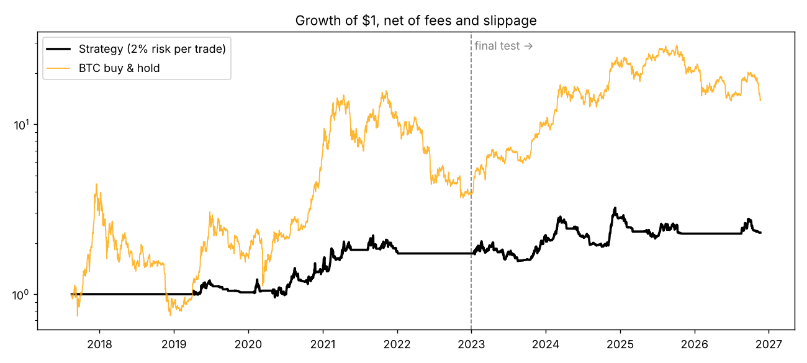

# Crypto swing breakout: backtest report

**70.9% of 815 trades won** (2018 → 2026, 20 coins). Final test period 2023 → 2026: **70.4%** of 365 trades.

## Rules

- **Entry:** the coin closes above its 20-day high and above its 200-day average, and BTC is above its 200-day average. Buy at the next day's open.
- **Take profit:** +10.5% (about +10% after costs). **Stop loss:** −20%. **Time stop:** 90 days.
- **Money management:** each trade risks 2% of the account at its stop, so each position is 10% of equity. At most 8 positions at once, no leverage.
- **Costs:** 0.10% fee + 0.05% slippage per side. A stop that gaps fills at the worse open price. If the stop and target are inside the same candle, the stop is assumed to hit first.

## Results

| | Trades | Win rate | Avg win | Avg loss | Profit factor | Return | CAGR | Max DD |
|---|---|---|---|---|---|---|---|---|
| Development 2018–2022 | 450 | **71.3%** | +10.2% | -20.2% | 1.26 | +74% | +10.8% | -22% |
| **Final test 2023–2026** | 365 | **70.4%** | +10.2% | -20.1% | 1.20 | +33% | +7.5% | -34% |
| Full history | 815 | **70.9%** | +10.2% | -20.2% | 1.23 | +130% | +9.4% | -34% |

Buy & hold BTC for comparison: development +286% (max DD -83%), final test +262% (max DD -53%).

Each win adds about +1.0% to the account and each loss costs about -2.0%. The worst single trade cost -2.0% of the account.

## By year

| | Trades | Win rate | Avg win | Avg loss | Profit factor | Return | CAGR | Max DD |
|---|---|---|---|---|---|---|---|---|
| 2019 | 51 | **68.6%** | +10.2% | -20.2% | 1.11 | +3% | +2.5% | -15% |
| 2020 | 155 | **74.8%** | +10.2% | -20.2% | 1.51 | +34% | +34.5% | -22% |
| 2021 | 244 | **69.7%** | +10.2% | -20.2% | 1.16 | +30% | +30.5% | -20% |
| 2023 | 115 | **73.9%** | +10.1% | -20.2% | 1.42 | +24% | +24.2% | -24% |
| 2024 | 152 | **73.0%** | +10.2% | -20.2% | 1.37 | +26% | +26.0% | -34% |
| 2025 | 60 | **58.3%** | +10.1% | -20.2% | 0.70 | -19% | -19.3% | -27% |
| 2026 | 38 | **68.4%** | +10.2% | -19.5% | 1.14 | +1% | +1.5% | -17% |

2018 and 2022 have no trades: BTC was below its 200-day average, so the market filter kept the bot in cash through both bear markets.

## By coin

| Coin | Trades | Win rate | Avg trade |
|---|---|---|---|
| ADA | 56 | 70% | +1.0% |
| ATOM | 31 | 55% | -3.5% |
| AVAX | 23 | 87% | +6.3% |
| BCH | 34 | 59% | -2.3% |
| BNB | 58 | 71% | +1.3% |
| BTC | 55 | 84% | +5.0% |
| DOGE | 43 | 67% | +0.3% |
| DOT | 14 | 57% | -2.8% |
| ETC | 43 | 67% | +0.3% |
| ETH | 65 | 75% | +2.7% |
| FIL | 20 | 65% | -0.4% |
| LINK | 47 | 66% | -0.1% |
| LTC | 42 | 69% | +0.8% |
| MATIC | 47 | 74% | +2.5% |
| NEAR | 23 | 65% | -0.4% |
| SOL | 46 | 78% | +3.6% |
| TRX | 53 | 66% | +0.0% |
| UNI | 29 | 72% | +1.8% |
| XLM | 36 | 81% | +4.3% |
| XRP | 50 | 72% | +1.7% |

## Money management: risk per trade

| Risk per trade | Position size | Trades | Win rate | Avg win | Avg loss | Profit factor | Return | CAGR | Max DD |
|---|---|---|---|---|---|---|---|---|---|
| 1% | 5% of equity | 815 | **70.9%** | +10.2% | -20.2% | 1.23 | +63% | +5.4% | -18% |
| 2% | 10% of equity | 815 | **70.9%** | +10.2% | -20.2% | 1.23 | +130% | +9.4% | -34% |
| 3% | 15% of equity | 797 | **71.1%** | +10.2% | -20.2% | 1.25 | +213% | +13.1% | -43% |

## Sensitivity: win rate over the full history for nearby settings

A robust setup should not depend on one exact number.

| Target \ Stop | −15% | −20% | −25% |
|---|---|---|---|
| +8.0% | 70% / PF 1.21 / +11% CAGR | 76% / PF 1.25 / +10% CAGR | 81% / PF 1.34 / +11% CAGR |
| +10.5% | 65% / PF 1.26 / +14% CAGR | 71% / PF 1.23 / +9% CAGR | 77% / PF 1.40 / +14% CAGR |
| +15.0% | 57% / PF 1.30 / +17% CAGR | 63% / PF 1.28 / +11% CAGR | 70% / PF 1.44 / +15% CAGR |
| +20.0% | 52% / PF 1.40 / +22% CAGR | 60% / PF 1.43 / +19% CAGR | 67% / PF 1.59 / +20% CAGR |
| +30.0% | 44% / PF 1.53 / +26% CAGR | 50% / PF 1.48 / +18% CAGR | 58% / PF 1.65 / +20% CAGR |

## Read before trading

- **How it reaches 70%:** a winner only needs +10%, while a loser must fall 20%, so the stop is twice the target. Each loss wipes out about two wins. The edge is real in this test but thin: profit factor is about 1.2.
- **Bigger targets lower the win rate.** At +30% or more, no setup tested reached 70%. You can have 70% winners or +30–100% winners, not both.
- **The final-test period isn't fully clean.** I saw 2023–2026 results while scanning entry types, so treat it as a strong check, not a guarantee. The sensitivity table is the better evidence.
- **Survivorship bias:** the basket is today's large coins. Coins that collapsed and were delisted aren't in it, so real results would likely be somewhat worse.
- **Correlation:** crypto coins fall together. Up to 8 positions × 10% means 80% of the account can be in the market during a crash, so gaps through stops can make losses bigger than −2% per trade.
- This is research code, not financial advice. Paper-trade it before risking money.
