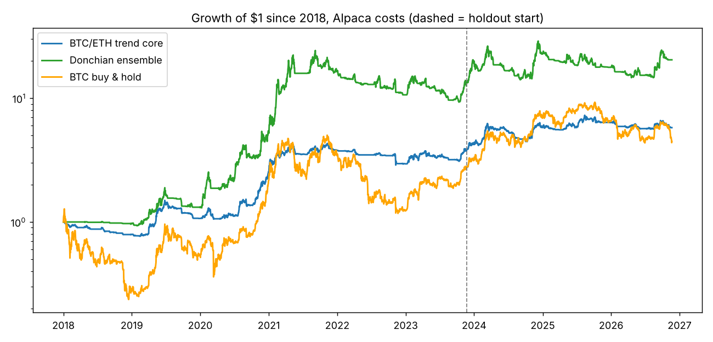

# Trend strategies v2: backtest against the research report's criteria

Rules come from `reports/Proven crypto trading strategies.md` and were fixed **before** any test was run. Nothing was tuned. The holdout is 2023-11-22 → 2026-11-21, as the report specifies.

Universe: 78 price series, including coins that were later delisted or collapsed (LUNA, FTT, BSV, SRM, HNT, MATIC, XMR, EOS, WAVES, OMG, FTM, MKR, …). This cuts survivorship bias. A coin whose history ends while held is sold at its last close.

## Development 2018-01 → 2023-11, Alpaca costs (0.35% per side)

| Strategy | CAGR | Sharpe | Max DD | Calmar | Vol | Win rate | Profit factor | Turnover/yr | Avg exposure |
|---|---|---|---|---|---|---|---|---|---|
| 2. BTC/ETH trend core | +25.1% | **1.00** | -33% | 0.76 | 26% | 29% | 3.14 | 4.0× | 29% |
| 1. Donchian ensemble, top-20 coins | +53.7% | **1.16** | -62% | 0.87 | 47% | 39% | 1.41 | 19.2× | 39% |
| BTC buy & hold | +18.1% | **0.60** | -81% | 0.22 | 72% | 100% | inf | 0.1× | 100% |
| BTC 200-day filter | +15.3% | **0.53** | -66% | 0.23 | 50% | 24% | 1.74 | 7.2× | 49% |
| BTC vol-matched to core | +17.3% | **0.68** | -48% | 0.36 | 30% | 100% | inf | 3.1× | 45% |
| BTC vol-matched to Donchian | +17.2% | **0.57** | -70% | 0.24 | 49% | 100% | inf | 3.6× | 74% |

## **Holdout 2023-11 → 2026-11**, Alpaca costs (0.35% per side)

| Strategy | CAGR | Sharpe | Max DD | Calmar | Vol | Win rate | Profit factor | Turnover/yr | Avg exposure |
|---|---|---|---|---|---|---|---|---|---|
| 2. BTC/ETH trend core | +14.7% | **0.72** | -28% | 0.53 | 23% | 37% | 2.35 | 5.2× | 41% |
| 1. Donchian ensemble, top-20 coins | +14.6% | **0.54** | -49% | 0.30 | 39% | 31% | 1.21 | 22.0× | 50% |
| BTC buy & hold | +16.9% | **0.57** | -53% | 0.32 | 47% | 100% | inf | 0.2× | 100% |
| BTC 200-day filter | +17.3% | **0.62** | -33% | 0.52 | 36% | 33% | 2.34 | 9.4× | 62% |
| BTC vol-matched to core | +7.4% | **0.41** | -39% | 0.19 | 25% | 100% | inf | 4.0× | 55% |
| BTC vol-matched to Donchian | +12.3% | **0.49** | -53% | 0.23 | 39% | 100% | inf | 2.8× | 86% |

## Pass/fail on the holdout (criteria from the report, Alpaca costs)

### Strategy 2: BTC/ETH trend core

| Criterion | Result | Detail |
|---|---|---|
| Sharpe ≥ BTC buy & hold + 0.2 | ❌ fail | 0.72 vs 0.57 |
| Sharpe ≥ vol-matched BTC + 0.2 | ✅ pass | 0.72 vs 0.41 |
| Max drawdown ≤ 40% | ✅ pass | -28% |
| Calmar ≥ 2× buy & hold | ❌ fail | 0.53 vs 0.32 |
| < 15 round trips per coin per year | ✅ pass | 3.2 |

### Strategy 1: Donchian ensemble

| Criterion | Result | Detail |
|---|---|---|
| Sharpe ≥ 1.0 | ❌ fail | 0.54 |
| Sharpe ≥ vol-matched BTC + 0.2 | ❌ fail | 0.54 vs 0.49 |
| Max drawdown ≤ 35% | ❌ fail | -49% |
| Positive alpha vs BTC | ✅ pass | +8.8%/yr, t = 0.5 |
| Profit factor ≥ 1.5 | ❌ fail | 1.21 |
| Turnover ≤ 8× per year | ❌ fail | 22.0× |
| Sharpe positive at 2× costs | ✅ pass | 0.34 |
| Sharpe drops < 30% with lookbacks ±30% | ✅ pass | −30%: 0.43, +30%: 0.61, base 0.54 |
| Beats the BTC/ETH core (kill condition) | ❌ fail | 0.54 vs 0.72 |

## Cost sensitivity on the holdout

| Strategy | Alpaca | Alpaca ×2 | Coinbase entry |
|---|---|---|---|
| BTC/ETH core | Sharpe 0.72, CAGR +14.7% | Sharpe 0.61, CAGR +12.0% | Sharpe 0.60, CAGR +11.7% |
| Donchian ensemble | Sharpe 0.54, CAGR +14.6% | Sharpe 0.34, CAGR +5.9% | Sharpe 0.32, CAGR +4.9% |

## Calendar-year returns (Alpaca costs)

| Year | BTC/ETH core | Donchian ensemble | BTC buy & hold |
|---|---|---|---|
| 2018 | -21% | -3% | -73% |
| 2019 | +35% | +36% | +94% |
| 2020 | +137% | +307% | +304% |
| 2021 | +49% | +208% | +59% |
| 2022 | -22% | -35% | -64% |
| 2023 | +44% | +79% | +156% |
| 2024 | +37% | +20% | +121% |
| 2025 | +10% | -22% | -6% |
| 2026 (to Nov 21) | -9% | +15% | -31% |

## Notes

- **Win rate is low by design:** about 30–35% of trades win, but winners are 2–3× the size of losers. That's what the research predicted for working trend systems.
- **Vol-matched BTC** is BTC scaled daily to the same volatility as the strategy, with no leverage. Beating it shows the trend signal adds something beyond simply holding less BTC.
- **Universe:** this is point-in-time by Binance dollar volume, which is not Alpaca's actual listing history. BTC uses Bitstamp prices and is always included. ETH history starts 2017-08, so tests start 2018-01.
- **Rebalance band:** the Donchian band is read as 'trade when the change is more than 3% of equity or more than 25% of the current weight', with a 1% minimum trade.
- Research code, not financial advice. Paper-trade before using real money.
